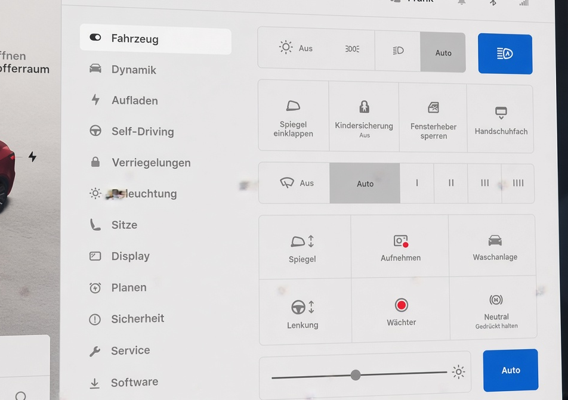
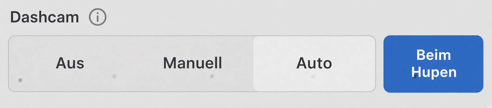
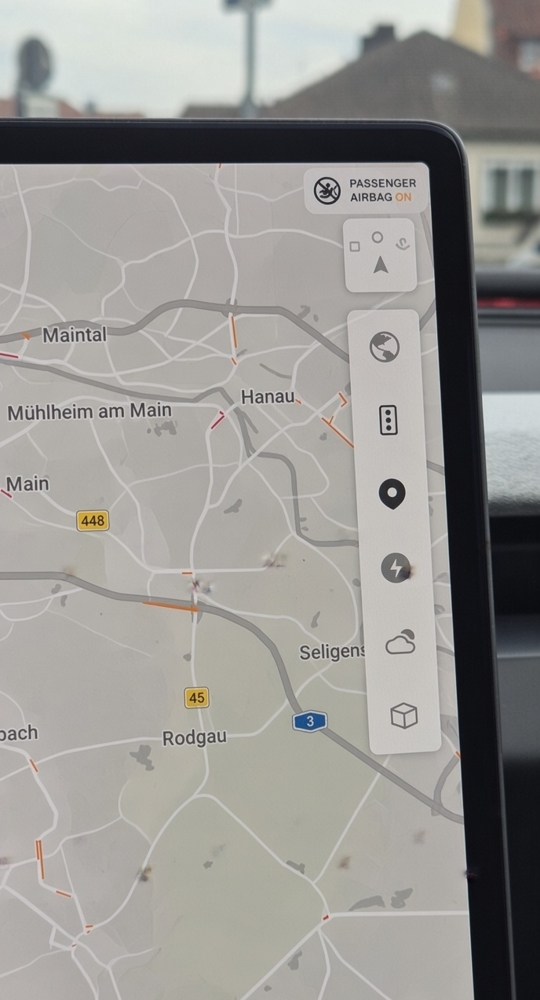

# 🚗 TFF e.V. Tesla Übergabe- & Einrichtungs-Guide

Herzlichen Glückwunsch zum neuen Tesla! Dieser Guide führt dich Schritt für Schritt durch die optimale Reihenfolge beim Erst-Setup – direkt bei der Übergabe oder später zu Hause beim Einrichten für weitere Fahrer.
!!! tip "WLAN im Delivery Center"
    SSID: `TESLA GUEST` | Passwort: `abcd123456`

---

## 📱 Phase 1: Smartphone & Profil-Einstellungen

- [ ] **1. Handyschlüssel & Profil-Verknüpfung**
  - **Handyschlüssel einrichten:** In der Tesla App auf *Handyschlüssel einrichten* tippen und die Keycard kurz auf die Mittelkonsole legen.
  - **Profil prüfen:** Unter *Fahrzeug > Verriegelungen* kontrollieren, ob dein Name und dein gekoppeltes Smartphone korrekt aufgeführt sind.

- [ ] **2. Bluetooth & Medien-Kopplung**
  - **Verbindung herstellen:** Den Verbindungsaufbau **immer im Bluetooth-Menü des Tesla** starten (*Fahrzeug > Bluetooth > Gerät hinzufügen*), sobald dein Handy aufgetaucht ist.
  - **Kopplungscode:** Den 6-stelligen Code auf dem Smartphone vergleichen und bestätigen.
  - **Standardgerät festlegen:** Das eigene Handy als *Priorisiertes Gerät* markieren.
  
!!! "Troubleshooting bei Scan-Problemen:"
    - **iPhone:** Bluetooth-Einstellungen explizit geöffnet halten.
    - **Pixel:** Smartphone komplett neustarten.
    - *Fehlgeschlagene Verbindung:* Vorgang erneut starten (kann im Center bis zu 5 Versuche benötigen).
  
---

## ⚙️ Phase 2: Fahrzeug- & System-Einstellungen

- [ ] **3. Sitz, Spiegel & Lenkrad einstellen**
  - Fahrersitz, Außenspiegel und Lenkrad anpassen.
  
!!! info "Speichern nicht vergessen!"
    Nach allen Einstellungen auf das kleine Pop-up oben im Display achten und immer auf **Speichern** tippen, um die Position fest in deinem Profil zu hinterlegen.

- [ ] **4. Beleuchtung, Wischer & Waschanlagenmodus**
  - **Licht & Wischer:** Scheinwerfer auf `AUTO`, Scheibenwischer auf `AUTO` stellen.
  - **Waschanlagenmodus:** Unter *Fahrzeug > Service > Waschanlagenmodus* testen. Dieser Modus sperrt Ladeklappe, Wischer und Fenster.
  
!!! info "Waschanlagenmodus"
    Hilfreich bei allen Arbeiten am Auto aussen und essenziell für automatische Waschstraßen, die das Auto ziehen.

- [ ] **5. Anzeige & Sicherheit**
  - **Anzeige:** Kontrast (Hell/Dunkel) anpassen. Reifendruck-Einheit **`BAR`** kontrollieren. Energieanzeige nach Wunsch auf % oder km (= Reichweite) stellen.
  - **Sicherheit:** Wächter-Modus (Sentry) und Dashcam aktivieren. { width="200" }
  - **Joe Mode** aktivieren (*Fahrzeug > Sicherheit*): Signaltöne werden leiser – ideal für Familien.
  
!!! info "Wächter-Modus"
    Der Modus verbraucht beim Parken ca. 2–3 % Akku pro Tag und benötigt einen formatierten USB-Stick im Handschuhfach."

- [ ] **6. Software & Trip-Bordcomputer**
  - **Software:** Fahrzeugname vergeben und speichern. Kennzeichen und Fahrzeugfarbe im Avatar änderbar.
  - **Trips:** Einen neuen Bordcomputer-Eintrag namens **„GESAMT“** anlegen.
  
!!! info "Trip Zähler GESAMT"
    Diesen Zähler **niemals löschen!** Perfekt für Langzeit-Verbrauchsübersicht, Kosten und Sommer/Winter-Vergleiche.

- [ ] **7. Klima & Innenraum**
  - Luftstrom-Steuerung, Auto-/Manuell-Modus.
  - Lenkradheizung sowie Sitzheizung/-lüftung (je nach Modell).
  - **Cabin Overheat Protection** (Überhitzungsschutz): An / Nur Lüfter / Aus – schützt das Interieur bei Hitze (max. ca. 12 Stunden oder bis Low-Power-Mode).
  - **Dog Mode / Pet Mode** und **Camp Mode** kurz zeigen (Keep Climate On) – Bildschirm bleibt an, Temperatur sichtbar, App-Überwachung möglich.

- [ ] **8. Audio-Einstellungen & Quellen**
  - Medien-Player öffnen (App-Launcher oder Lautstärke-Leiste unten).
  - **Quellen verwalten:** *Fahrzeug > Audio* (oder Zahnrad über der Lautstärkeregelung) → Quellen. Unbenutzte Apps/Quellen ausblenden (z. B. Tidal, Amazon Music, TuneIn…), damit es übersichtlich bleibt.
  - Equalizer / Ton: Bass, Mitten, Höhen, Subwoofer (bei Premium-Audio zusätzlich Immersive Sound).
  - Balance (Mittelpunkt des Sounds verschieben).
  - Optionen: Explicit Content, DJ-Commentary, Mobile Control erlauben.

- [ ] **9. Laden & Batterie**
  - **Ladelimit** einstellen (*Fahrzeug > Laden*): Täglich 80 % (bei NMC-Akkus). Bei LFP-Akkus (Standard Range) darf dauerhaft 100 % geladen werden.
  - Geplantes Laden / Abfahrtszeit im Auto oder über die App einstellbar für Vorkonditionierung + Laden fertig zur gewünschten Zeit.

| Ladeoptionen | Anbieter | Typ | Stecker | Start | Abrechnung |
| :--- | :--- | :--- | :--- | :--- | :--- | 
| **Supercharger** | TESLA | DC-Schnellladen 175 -250 kW | CCS Kabel am Supercharger | Plug&Charge | Abrechnung über Bezahlart in der Tesla APP |
| **Schnelllader / HPC Lader** | EnbW, Aral, Ionity, usw. | DC-Schnellladen 175 -250 kW | CCS Kabel am Schnellader | Plug&Charge (optional) | Abrechnung über eigene APP, Kreditkarte oder Ladekarte |
| **Ladesäule** | div. Anbieter | AC-Laden 11 kW | Type 2 Steckdose (hier benötigt man das Ladekabel) | Start mit Karte | Ladekarte |
| **Destination Charger** | Tesla | AC-Laden 11 kW | Type 2 Kabel am Charger | Plug&Charge | Bei Hotels oder Restaurants, die dann selbst abrechnen |
| **Wall Connector** | Tesla | AC-Laden 11 kW | Type 2 Kabel am Charger | Plug&Charge | Der Destination Cherger für zuhause |
| **Wallbox** | privat | AC-Laden 11 kW | Type 2 Steckdose (hier benötigt man das Ladekabel) oder Kabel | Start sofort oder mit Karte / Schalter | Zuhause |
  
- [ ] **10. Fahren & One-Pedal-Driving**
  - Der **Haltemodus** ist bei aktuellen Fahrzeugen fest auf „Halten“ eingestellt und kann nicht mehr geändert werden.
  - Das Auto hält vollständig an, sobald man vom Pedal geht (echtes One-Pedal-Driving). Kurz erklären und testen, damit neue Fahrer sich daran gewöhnen.

---

## 🏎️ Phase 3: Bedienung, Navigation & Test-Routing

- [ ] **11. Lenkradbedienung & Sprachsteuerung**
  - **Mikrofon-Taste:** Sprachbefehle testen (*"Navigiere nach Hause"*, *"Handschuhfach öffnen"*, *"Klima auf 21 Grad"* uvm. inkl. Grok-Assistenz).
  - **Scheibenwischer-Taste:** Kurz drücken = einmal wischen; lang drücken = Scheibenwaschanlage.
  - **Kameras:** Umschaltung auf dem Display (Vorne/Hinten) und Frontkamerareinigung.
  - **Fahrassistenten:** Lichthupe und Tempomat/Autopilot-Aktivierung, Geschwindigkeitseinstellung verinnerlichen.

- [ ] **12. Navigation & Supercharger-Demo**
  - **Zuhause-Adresse:** Unter Navigation „Zuhause“ eingeben und speichern (künftig durch kurzes Nach-Unten-Wischen auf der Navigationsleiste direkt aufrufbar).
  - **Supercharger-Demo:** Ein Ziel eingeben (z. B. *"Supercharger Würzburg"* – keine genaue Adresse nötig).
  - **Routenplanung:** Supercharger auf der Strecke anzeigen lassen und einen Stopp zur Probe hinzufügen (demonstriert Ladeplanung und Akku-Vorkonditionierung).

| Anzeige | Optionen auf der Navi-Anzeige |
| :---: | :--- |
| { width="220" } | *(Aufruf durch einmaliges Tippen auf die Karte)*  🗺️ **Kartenansicht / Satellitenbild** 🚗 **Verkehrslage** 📍 **Mein Standort** ⚡ **Supercharger** 🌤️ **Wettervorhersage** 🧊 **3D-Ansicht** |

---

## 📦 Phase 4: Außenbereich & Zubehör

- [ ] **13. Frunk (Vorderer Kofferraum) & Zubehör**
  - Frunk per App oder Display öffnen.
  - **Korrektes Schließen:** Mit beiden Handflächen links und rechts neben dem Tesla-Emblem sanft herunterdrücken (nicht mittig schlagen!).
  - **Inhalt kontrollieren:** Warndreieck, Verbandskasten, Warnweste und Ladekabel (Typ 2 / Mobile Connector) prüfen.

- [ ] **14. Heckkofferraum & Ladeklappe**
  - **Kofferraum:** Öffnen und Stopp-Funktion sowie Einstellung der Öffnungshöhe testen (Taste am Deckel auf gewünschter Höhe gedrückt halten, bis ein Signalton ertönt, und am Display bestätigen).
  - **Ladeklappe:** Öffnung (Tippen auf Klappe oder Kabel-Knopf) und Schließautomatik prüfen.

!!! warning "Ladeklappe schliesst automatisch"
    Niemals **manuell** zudrücken!

- [ ] **15. Türen & Notentriegelung**
  - Öffnen der Türen von außen und innen ausprobieren.
  - Position und Handhabung der **mechanischen Notentriegelungen** für den Notfall kennenlernen:
    - **Vordertüren:** Hebel direkt vor den Fensterschaltern nach oben ziehen.
    - **Fondtüren** (bei den meisten neueren Modellen): Matte im Türfach entfernen → Abdeckung abziehen → Seilzug nach vorne ziehen.
  
!!! warning "Türen nur im Notfall manuell öffnen"
    Beim manuellen Türöffnen senkt sich das Fenster nicht automatisch ab – Scheibe oder Verkleidung können beschädigt werden. Nur im echten Notfall verwenden.

---

## 💡 Allgemeine Hinweise

- **Premium-Konnektivität:** Ist ab Übergabe **4 Wochen kostenlos inklusive** (Live-Verkehrsdaten, Spotify, Satellite-Maps, Video-Streaming). Danach optional für 9,99 € / Monat über die Tesla App buchbar.
- **Weitere Fahrer einladen:** In der Tesla App unter *Fahrzeug verwalten > Fahrer hinzufügen* den Einladungslink einfach per Messenger versenden. Profile (Sitz, Spiegel, Audio-Vorlieben) kommen cloud-basiert mit.
- **Software-Updates:** Regelmäßig prüfen und idealerweise nachts über WLAN installieren.
- **Offizielles Handbuch:** Im Auto unter App-Launcher → Manual jederzeit verfügbar.

---

!!! tip "Guide teilen & gemeinsam nutzen 📱"
    Dir gefällt dieser Guide und du möchtest ihn teilen oder direkt auf dem eigenen Smartphone mitlesen und abhaken?

    

      
      
<em>Einfach mit der Smartphone-Kamera scannen & direkt aufrufen</em>

    

## ℹ️ Projekt-Informationen

| Eigenschaft | Details |
| :--- | :--- |
| **Version:** | `v1.0.1` (Stand: Oktober 2026) |
| **Herausgeber:** | TFF e.V. Supporter Team |
| **Lizenz:** | [MIT License](https://opensource.org/licenses/MIT) – Frei nutzbar, anpassbar und weiterverwendbar. |
| **Quellcode:** | Open Source auf GitHub |

!!! info "Mithelfen & Fehler melden"
    Hast du Änderungen durch ein neues Tesla-Software-Update entdeckt? Verbesserungsvorschläge nehmen wir gerne als Issue oder Pull Request im Repository entgegen!
